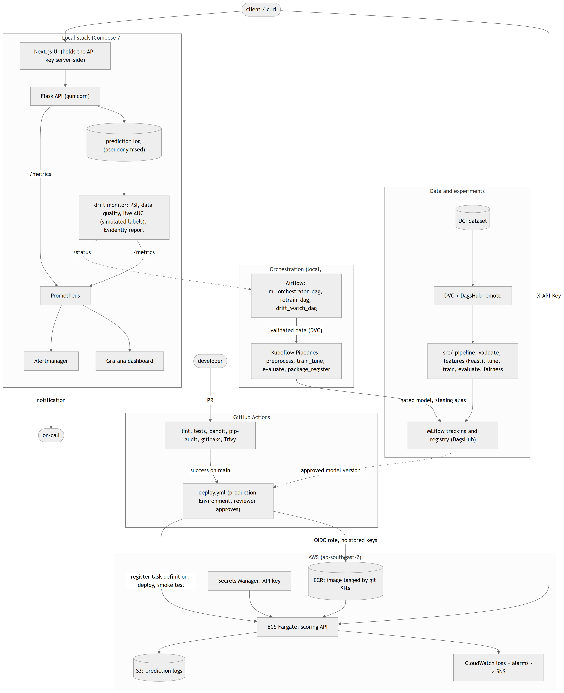

# Credit Risk Intelligence Platform

[](https://github.com/Hashir-Rauf/Credit-Risk-Intelligence-Platform/actions/workflows/ci.yml)

End-to-end MLOps system that predicts next-month credit-card default, then serves, monitors and retrains the model. FAST-NUCES MLOps course project (3 students). **A coursework system, not a lending tool.**



## Where the project stands
| Area | State | Read |
|---|---|---|
| Data, DVC, DagsHub (Phase 1) | done | [dvc-runbook.md](docs/dvc-runbook.md) |
| Modelling, MLflow, Feast (Phase 2) | done | [model-selection.md](docs/model-selection.md), [model-card.md](docs/model-card.md) |
| Tests and CI (Phase 3) | done | [ci.md](docs/ci.md) |
| Serving: Flask API, Docker, UI (Phase 4) | done | [serving.md](docs/serving.md) |
| Orchestration: Airflow + Kubeflow (Phase 5) | done, run end to end | [orchestration.md](docs/orchestration.md), [kubeflow-setup.md](docs/kubeflow-setup.md) |
| AWS deployment and CD (Phase 6) | code and docs written and statically checked; **not yet run on AWS** | [aws-deployment.md](docs/aws-deployment.md) |
| Kubernetes scaling demo (Phase 7) | done locally (Minikube) | [kubernetes.md](docs/kubernetes.md) |
| Monitoring, drift, retraining, promotion (Phase 8) | done locally (Compose + Airflow); promotion workflow written, not yet run | [promotion-rollback.md](docs/promotion-rollback.md) |
| Security, ethics, docs (Phase 9) | audit and risk assessment written | [security.md](docs/security.md), [risk-assessment.md](docs/risk-assessment.md), [REPORT.md](REPORT.md) |

Plan and rules: [plan.md](plan.md), [phases.md](phases.md), [rules.md](rules.md). Evidence per phase: [docs/evidence/](docs/evidence/).

## Dataset
UCI *Default of Credit Card Clients* (30,000 rows, 23 features). Source: https://archive.ics.uci.edu/dataset/350. Used for coursework only; not a real lending decision tool.

**Licence:** [Creative Commons Attribution 4.0 International (CC BY 4.0)](https://creativecommons.org/licenses/by/4.0/). The data is downloaded at run time and versioned with DVC; it is not redistributed in git.

**Citation:** Yeh, I-C. (2009). *Default of Credit Card Clients* [Dataset]. UCI Machine Learning Repository. https://doi.org/10.24432/C55S3H. Original study: Yeh, I-C. and Lien, C-H. (2009). The comparisons of data mining techniques for the predictive accuracy of probability of default of credit card clients. *Expert Systems with Applications*, 36(2), 2473-2480.

## Prerequisites
Python 3.11+, Git, Docker Desktop (8 GB RAM or more; more if you also run Kubeflow), Node 20+ (frontend), `kubectl` and Minikube (Kubernetes demo, Kubeflow), AWS CLI v2 (AWS deployment only), DVC. A DagsHub account and token for the shared data/experiment remote (the S3 DVC remote needs the AWS profile `credit-risk`).

## Set up
```bash
git clone https://github.com/Hashir-Rauf/Credit-Risk-Intelligence-Platform.git && cd Credit-Risk-Intelligence-Platform
python -m venv .venv && source .venv/bin/activate   # Windows: .venv\Scripts\activate
make setup                  # install dev dependencies and the pre-commit hooks
cp .env.example .env        # fill in the values; never commit .env
```
Remote credentials live in the gitignored `.dvc/config.local`:
```bash
dvc remote modify --local dagshub user <dagshub-user>
dvc remote modify --local dagshub password <dagshub-token>
dvc remote modify --local s3 profile <your-aws-profile>      # only for the S3 remote
```

## Get the data and reproduce the model
```bash
dvc pull -r dagshub         # data, models/ and reports from the DagsHub remote
dvc repro                   # ingest -> validate -> preprocess -> feast -> tune -> train -> evaluate -> fairness, explain, drift
dvc dag
```
`dvc repro` exits with code 3 when the quality gate fails (ROC-AUC below the threshold in `params.yaml`); nothing downstream may then deploy.
No data or credentials? A synthetic smoke run exercises the same code:
```bash
for m in src.data.synthetic src.features.preprocessing src.features.feast_features src.models.tune src.models.train src.models.evaluate; do python -m $m --smoke; done
```

## Run the tests
```bash
make lint                   # ruff + black
make test                   # pytest with coverage (unit, data, model, API, regression, monitoring)
make security               # bandit + pip-audit, the same as CI
(cd frontend && npm ci && npm run lint && npm run typecheck && npm test)
```
Pipeline tests are split by environment (Airflow, Kubeflow, ML): see [docs/orchestration.md](docs/orchestration.md) "Verify the code" and `.github/workflows/phase5.yml`.

## Run the stack locally
```bash
cp .env.example .env        # set API_KEY (16+ characters), POSTGRES_PASSWORD, GRAFANA_ADMIN_PASSWORD
dvc pull -r dagshub         # models/model.joblib etc.
docker compose -f docker-compose.yml -f docker-compose.dev.yml up --build -d     # dev: every port on localhost
docker compose -f docker-compose.yml -f docker-compose.prod.yml up -d            # prod-style: read-only containers, fewer ports
```
UI http://localhost:3000 · API http://localhost:8000 (`/health`, `/model-info`, `/predict`, `/explain`, `/metrics`) · Grafana http://localhost:3001 (dashboard *Credit risk service*) · Prometheus :9090 · Alertmanager :9093 · MLflow :5000 · drift monitor :9101 (dev override).
```bash
curl -s -X POST http://localhost:8000/predict -H "X-API-Key: $API_KEY" -H "Content-Type: application/json" -d @scripts/sample_predict.json
```
The score returned is a **risk score, not a calibrated probability**. Details, error codes and the BentoML path: [docs/serving.md](docs/serving.md).

## Monitoring, drift and retraining
```bash
python scripts/simulate_drift.py --scenario no_drift          # normal traffic (SIMULATED)
python scripts/simulate_drift.py --scenario payment_delays    # drifted traffic (SIMULATED); watch Grafana and `docker compose logs alert-sink`
```
Drift, the delayed labels and the alert evidence are simulated and labelled so everywhere. The retrain DAG, the decision rules, promotion and rollback are in [docs/promotion-rollback.md](docs/promotion-rollback.md).

## Orchestrate the whole pipeline (Airflow + Kubeflow)
```powershell
minikube start -p credit-risk --driver=docker
.\scripts\phase5.ps1 -Action Build
.\scripts\phase5.ps1 -Action Start -Profile credit-risk       # Airflow UI at http://localhost:8085
```
Then trigger `ml_orchestrator_dag` (one trigger: validated data → Kubeflow run → evaluated, registered model). Full steps and the scenarios (corrupt data, failed gate, retry): [docs/orchestration.md](docs/orchestration.md).

## Kubernetes scaling demo (local)
```bash
KCTX=credit-risk ./scripts/k8s_demo.sh | tee docs/evidence/phase-7/k8s-demo.log
```
Scaling, self-healing, probes, load spreading, rolling update and rollback: [docs/kubernetes.md](docs/kubernetes.md).

## Deploy to AWS and tear it down
Costs money (about US$0.02-0.03 per hour while running); read [docs/aws-deployment.md](docs/aws-deployment.md) first, in particular the OIDC risk.
```bash
ALERT_EMAIL=you@example.org ALLOWED_CIDR=<your-ip>/32 ./infra/aws/setup.sh     # foundation + service (0 tasks)
# merge to main -> CI -> Deploy workflow (a reviewer approves the "production" environment)
./infra/aws/endpoint.sh --key                                                    # URL and API key
./infra/aws/teardown.sh --yes                                                    # removes everything, then lists what is left
```

## Security
No secrets in git (pre-commit + gitleaks on full history), OIDC instead of AWS keys, least-privilege IAM, non-root containers, API key on every business endpoint, request size and rate limits, bandit / pip-audit / Trivy in CI. The audit against `rules.md` is in [docs/security.md](docs/security.md); the risks are in [docs/risk-assessment.md](docs/risk-assessment.md).

## Troubleshooting
| Symptom | Likely cause and fix |
|---|---|
| `dvc pull` asks for credentials or 401s | set `.dvc/config.local` (above); the DagsHub token must be a token, not the password |
| `dvc repro` exits 3 | the quality gate failed: that is correct behaviour; read `reports/evaluation.json` |
| API container is `unhealthy` / `/health` is 503 | no model inside: mount `./models` (`dvc pull`) or use `--target with-model` |
| Compose says a variable is required | `.env` is missing `API_KEY`, `POSTGRES_PASSWORD` or `GRAFANA_ADMIN_PASSWORD` |
| Grafana shows "No data" for drift panels | the monitor needs `MONITOR_MIN_ROWS` (200) predictions in its window and `data/reference/reference.parquet` (`dvc repro`) |
| `phase5.ps1` complains about the Docker network | start the cluster first: `minikube start -p <profile> --driver=docker` |
| Airflow shows runs stuck as `running` after Docker restarted | the task died with the container; mark the run failed and trigger a new one |
| The AWS setup fails creating the OIDC provider | an organisation policy may block it: see the risk section of [docs/aws-deployment.md](docs/aws-deployment.md) |
| Windows: `kubectl` cannot find `/e/...` paths | run scripts from the repository root with relative paths (the scripts already do) |

## Repository layout
`src/` modelling, serving and monitoring code · `pipelines/` Airflow DAGs, Kubeflow pipeline, retrain helpers · `configs/`, `params.yaml` · `feature_repo/` Feast · `docker/`, `docker-compose*.yml` · `frontend/` Next.js UI · `k8s/` Kubernetes manifests · `infra/aws/` CloudFormation and scripts · `monitoring/` Prometheus, Alertmanager, Grafana · `scripts/` operator scripts · `tests/` · `docs/` (and `docs/evidence/`). Details: [plan.md](plan.md) section 4.

## Team
| Member | Role |
|---|---|
| S1 (`@JA-Codex`) | Data & ML Engineering |
| S2 (`@Hashir-Rauf`) | MLOps & Automation (pipelines, CI/CD) |
| S3 | Deployment & Reliability |

## Contributing
Branch from `main` (`feat/…`, `fix/…`), open a PR, get one review and green CI. Never push to `main`. See [rules.md](rules.md).
