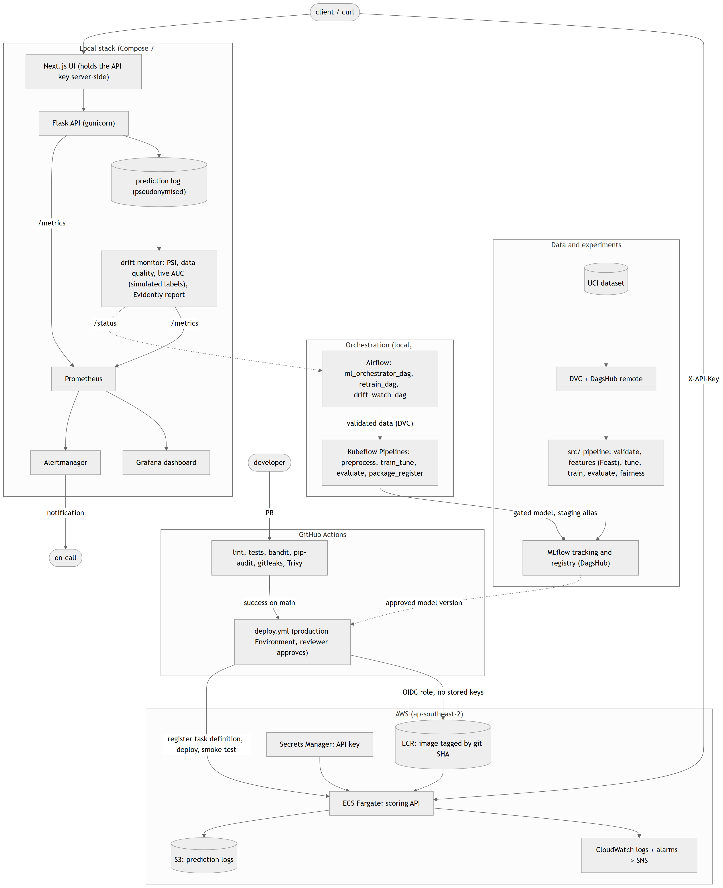
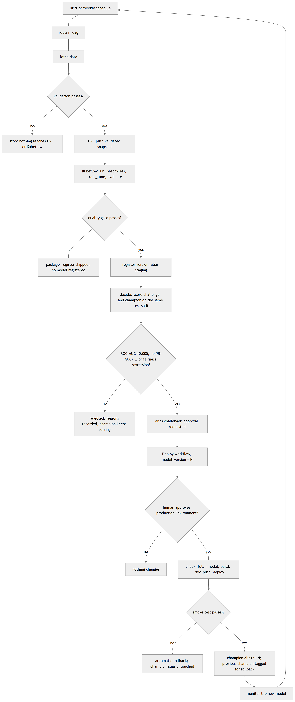

# Credit Risk Intelligence Platform: project report

FAST-NUCES, MLOps (Semester 7). Group 14: Hashir Rauf (23L-2572), Junaid Minhas (23L-2559), Ahsan Ijaz (23L-2617). A coursework system that predicts next-month credit-card default, then serves, monitors and retrains the model.
It is **not** a lending tool; every interface says so.

> The formatted final report with all metrics and screenshots is [report/main.tex](report/main.tex) (build: [report/README.md](report/README.md)).
>
> Status honesty: the AWS deployment (API and web UI on ECS Fargate) was applied on 2026-11-27 and is described in [docs/aws-deployment.md](docs/aws-deployment.md) and [docs/evidence/phase-6/](docs/evidence/phase-6/README.md). Cost Explorer was captured (total -$0.00, covered by credits). Still **not** demonstrated on AWS: the teardown. The rollback run succeeded (revision 6 to 5) and the 5xx alarm was set to ALARM by a manual state change, not by a real error; no Deploy run blocked by a failing gate was run on AWS. Drift, delayed labels and feature timestamps are **simulated** and labelled so everywhere.

## 1. Problem
Banks need to rank customers by default risk and keep the ranking trustworthy as customers change. The engineering problem here is not the model but everything around it: versioned data, reproducible training, a gate that stops bad models, a serving path with rollback, observability, and a retraining loop that never promotes a model on its own.

## 2. Data
UCI *Default of Credit Card Clients*: 30,000 customers, 23 attributes, 22.1 % defaulted next month (Taiwan, 2005; CC BY 4.0). Stratified split 70/15/15 with a fixed seed; tuning uses the validation split and the test split is read only for final evaluation. The data is old, from one country and one bank, so it does not represent current populations. `SEX`, `MARRIAGE` and `AGE` are not model inputs and are used only to audit fairness ([fairness.md](docs/fairness.md)).

## 3. Architecture

* **Data and experiments:** DVC (S3 and DagsHub remotes) versions data and models; MLflow on DagsHub tracks runs and holds the registry (`credit-risk-default-model`, aliases `champion`, `staging`, `challenger`); Feast supplies features.
* **Orchestration:** Airflow triggers one pipeline run; Kubeflow Pipelines on Minikube executes preprocess → train/tune → evaluate → package/register with a quality-gate branch.
* **Serving:** Flask under gunicorn, API-key authentication, schema-generated validation, Prometheus metrics; a Next.js UI that keeps the key server-side; a BentoML packaging of the same model.
* **Delivery:** GitHub Actions (CI: lint, tests, scanners, image scan; CD: build, scan, push to ECR by git SHA, ECS deploy, smoke test, rollback) with a manual approval Environment and OIDC instead of stored AWS keys.
* **Operations:** Prometheus, Grafana, Alertmanager; a pseudonymised prediction log; a drift monitor (PSI, data quality, live AUC from replayed labels, Evidently HTML report); a retrain DAG and a promotion/rollback procedure.
* The workflow of a retrain and promotion: 

## 4. Decisions and trade-offs
| Decision | Why | Cost / trade-off |
|---|---|---|
| Random forest champion (ROC-AUC 0.788) chosen from three tuned families | Best validation ROC-AUC; documented in [model-selection.md](docs/model-selection.md) | Scores are **uncalibrated**, so the API returns `risk_score`, never a probability |
| Sensitive attributes excluded from inputs | Fairness rule; ablation shows using them adds nothing (ΔAUC −0.0003) | Other features still act as proxies; an age-band TPR gap (0.128) and AUC gap (0.083) remain and are monitored |
| Gate at ROC-AUC ≥ 0.77 in config; challenger must beat champion by +0.005 with no PR-AUC/KS/fairness regression | Predefined, same holdout (rules.md §5) | A retrain on unchanged data can never win: the live demo shows the *rejection* path |
| Airflow orchestrates, Kubeflow computes | Course requirement; clear split of ingestion/scheduling vs the pod graph | Two systems to run; Kubeflow is heavy on a laptop |
| Deterministic outcomes (bad data, rejected gate) are not retried | Retrying cannot change them and wasted minutes in the first live run | Needed exit-code contract (2, 3) between the helpers and the DAG |
| Request id = hash(run id, DagRun start time) | The first live run collided with a teammate's run on the shared MLflow server (same scheduled run id) | Documented in `docs/evidence/phase-5/found-and-fixed/` |
| ECS Fargate (one task, 0.5 vCPU with the web UI as a second container, no load balancer, no NAT) | Lowest cost that satisfies the spec | HTTP only, public IP changes per deploy, one task (documented, accepted) |
| CloudFormation instead of Terraform | One tool already installed; stack deletion makes teardown reliable | AWS-only |
| `champion` alias moves only after a smoke-tested deployment | The registry must never name a model that is not serving | Promotion is a deploy workflow run, not a separate button |
| Retrain watcher with a 6 h cooldown | Drift persists after a retrain request; without it the watcher re-triggered (seen live, twice) | A second real incident inside 6 h waits |

## 5. Results
* **Model (test split, threshold 0.5):** ROC-AUC 0.7883, PR-AUC 0.578, KS 0.440, recall 0.600, precision 0.509 ([model-card.md](docs/model-card.md)).
* **Orchestration (Phase 5):** a real-data run succeeded end to end (7/7 tasks, one Kubeflow run, staging model v4, champion untouched); corrupt data stopped at validation on the first attempt; a strict gate skipped registration and failed `check_gate` once, with no retry; a deliberate transient failure was retried once and succeeded ([evidence](docs/evidence/phase-5/acceptance-run.md)).
* **Kubernetes (Phase 7):** two replicas shared 600 requests 303 / 297; a deleted pod was replaced; a failing readiness probe kept a pod out of the Service while the old pods served; rolling update and rollback worked ([evidence](docs/evidence/phase-7/README.md)).
* **Monitoring (Phase 8, simulated drift):** payment-status drift put 10 of 20 inputs above PSI 0.2 (max PSI 5.6); live AUC fell from 0.78 to 0.55; `DataDriftDetected` fired and resolved with notifications recorded; the 5xx and p95-latency alerts were also triggered once each ([evidence](docs/evidence/phase-8/README.md)).
* **Retraining (Phase 8):** a drift-triggered `retrain_dag` run trained challenger v6, which reproduced the champion's metrics exactly (ROC-AUC 0.7883); the decision step **rejected** it (gain +0.0000 < +0.005) and the champion v1 kept serving. A better challenger being promoted was not shown live (unit-tested only).
* **AWS (Phase 6):** the foundation and service stacks were created; the Deploy workflow (CI, approval, OIDC, quality gate, build, Trivy, ECR push by git SHA, ECS deploy, smoke test) deployed the API and the web UI as two containers of one Fargate task; `/health`, a 401 without the key and an authenticated prediction were checked from outside ([evidence](docs/evidence/phase-6/README.md), [aws-deployment.md](docs/aws-deployment.md)). Rollback (revision 6 to 5) passed its smoke test; the 5xx alarm was triggered manually. Cost Explorer captured. Pending: teardown.
* **Security (Phase 9):** audit against `rules.md` in [security.md](docs/security.md); scanner outputs in [docs/evidence/phase-9/](docs/evidence/phase-9/README.md).

## 6. Automation versus manual steps
| Step | Automated | Manual gate |
|---|---|---|
| Lint, tests, scanners, image build and scan on every push | yes | merge needs a review and green CI |
| Data fetch, validation, DVC publication, training, evaluation, registration | yes (one Airflow trigger) | none |
| Quality gate | yes; below threshold nothing is registered or deployed | none (and it cannot be waived) |
| Drift detection and retrain trigger | yes (monitor → watcher → `retrain_dag`) | none |
| Challenger vs champion decision | yes (predefined rules) | accepting a challenger is a human act |
| Promotion to `champion` and deployment to production | the workflow does the work | **required reviewer approves** the `production` Environment |
| Rollback | automatic on a failed smoke test | manual rollback or re-promotion of the previous champion |
| AWS teardown | one script | someone must run it and confirm in the console |

## 7. Monitoring and retraining
See [promotion-rollback.md](docs/promotion-rollback.md). In short: the API's pseudonymised prediction log feeds a monitor that publishes drift, data-quality and live-performance metrics; three alert families (API errors/latency, drift/quality, performance) go to Alertmanager; `drift_watch_dag` starts `retrain_dag`, which compares the new model with the champion on the same split and **recommends** (never performs) a promotion.

## 8. Risks
Eleven risks with mitigations and evidence are in [risk-assessment.md](docs/risk-assessment.md); the open ones are the possibly blocked GitHub OIDC provider, a single-person approval gate and an unconfirmed hard AWS spend limit.

## 9. Lessons learned
* **Run it for real.** Almost every real bug appeared only in a live run: a request-id collision on a shared server, retries of non-retryable failures, a helper whose errors were invisible in the task log, Windows quoting that broke `kubectl`, a self-healing demo that deleted a pod already terminating, a watcher that re-triggered every ten minutes.
* **Make deterministic outcomes first-class.** An exit-code contract (validation 2, gate 3) turned wasted retries into immediate, readable failures.
* **Evidence beats claims.** Where something was not run (AWS, the HPA, a better-than-champion challenger) the documents say so instead of implying it.
* **Cost and safety are design inputs.** The design avoids a load balancer and NAT gateway, scopes IAM to single resources, and makes teardown a stack deletion.
* **Simulated data needs a label.** It is easy for a convincing dashboard to be mistaken for field evidence.

## 10. Individual contribution statement
Contributions are taken from the Git history (`git shortlog`) and the ownership map in [.github/CODEOWNERS](.github/CODEOWNERS); each member should confirm or amend this before submission.

| Member | Contribution |
|---|---|
| **S2 / `@Hashir-Rauf`** | Repository governance and CI/CD (Phases 0, 3); data ingestion and validation; Flask API, Docker images, Compose stacks and the Next.js UI (Phase 4); Airflow acceptance runs and fixes (Phase 5); AWS infrastructure, deploy and rollback workflows (Phase 6); Kubernetes manifests and demo (Phase 7); monitoring, prediction log, drift monitor, retrain DAG, promotion workflow (Phase 8); security audit, risk assessment, documentation (Phase 9). Most commits in the history. |
| **S1 / `@JA-Codex`** | Modelling: features, Feast, tuning, training, evaluation, fairness, explanations, simulated drift scenarios and the promotion rules (`src/features`, `src/models`, `src/common`, `configs`, `feature_repo`, notebooks, the modelling tests). Phase 5 (Airflow/Kubeflow) was merged through PR #9 and then verified and fixed by `@Hashir-Rauf` in the acceptance runs; check `git log` for the exact split. |
| **S3** | Reviews and project coordination; no code in the repository (recorded in `memory.md`). |

The AI coding assistant used for parts of the implementation did not author any commit; all commits are made under the team members' own identities, as `rules.md` §11 requires.
